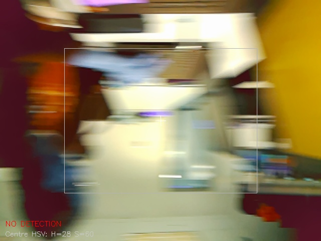

# Reaction Wheel Platform

A simplified reaction wheel (flywheel) for a satellite-style attitude control application, built by Group 3 in the UT Austin Freshman Research Initiative (FRI) Space and Robotics Stream, Spring 2026.

A motor spins a flywheel on a rotating platform. Because angular momentum is conserved, speeding the flywheel up or down turns the platform the opposite way, which is how satellites point without using thrusters. In the final demo, a Raspberry Pi 5 uses a camera to find a bright green rectangular object, then drives the flywheel so the platform turns to face it and keeps it centered.

<!-- TODO: add a photo or GIF of the demo here, e.g.  -->
<!-- TODO: add a link to the project paper once it is found -->

## How it works

The demo (`DemoPart2`) is a two-state controller that runs at 120 Hz.

| State | What happens |
|-------|--------------|
| `SEARCH` | The flywheel spins the platform slowly (8% duty cycle). The direction comes from where green was last seen: the outer 25% of each side of the frame counts as a "side zone," and the platform turns toward the zone that had green. |
| `LOCKED` | A PID controller drives the horizontal offset between the object's center and the frame center to zero. If the object stays out of view for 20 frames, the state returns to `SEARCH`. |

Details:

- **Detection:** Each 160x120 frame is converted to HSV and thresholded for bright green. Morphological open and close operations remove noise. The largest contour above a minimum area is the target, and its centroid is computed with `cv2.moments`.
- **Control:** The error is the contour's horizontal offset from the frame center, normalized to -1.0 (far left) through +1.0 (far right). Within a 5% dead band the motor holds still, which prevents buzzing when the target is nearly centered. Output is clamped to 80% duty.
- **Threading:** Camera capture and detection run in their own thread so the control loop never waits on a frame.
- **IMU:** The BNO08x gyroscope and rotation vector are combined to get the platform's yaw rate about its vertical axis. In this demo it is used for logging, and the camera PID drives the motor.

## Hardware

| Part | Notes |
|------|-------|
| Raspberry Pi 5 | Runs all of the software |
| Raspberry Pi camera | Read through `picamera2` |
| BNO08x IMU | Connected over I2C (the default Pi SDA and SCL pins) |
| DC motor with flywheel | Driven with PWM through an H-bridge driver |
| Quadrature encoder | 14 ticks per revolution |

GPIO pins (BCM numbering), set at the top of `DemoPart2`:

| Signal | Pin |
|--------|-----|
| Motor `RPWM` | 12 |
| Motor `LPWM` | 13 |
| Motor `R_EN` | 22 |
| Motor `L_EN` | 23 |
| Encoder A | 5 |
| Encoder B | 6 |

## Repository layout

| Path | Contents |
|------|----------|
| `DemoPart2` | Final demo: find the green object, then track it with PID |
| `DemoPart1` | First part of the demo |
| `Checkpoint1`, `Checkpoint2` | Code from the project checkpoints |
| `motorTesting` | Motor driver and PWM tests |
| `encoder`, `encoder.py` | Encoder reading and tests |
| `imu` | IMU reading and tests |
| `CameraTesting`, `snapshot.py` | Camera tests and image capture |
| `rotationalSpeedByHand` | Rotational speed measurements |

## Setup

On Raspberry Pi OS:

1. Enable I2C: `sudo raspi-config` -> Interface Options -> I2C.
2. Install the camera and vision libraries:
   ```bash
   sudo apt install python3-picamera2 python3-opencv python3-numpy
   ```
3. Install the hardware libraries:
   ```bash
   pip install adafruit-blinka adafruit-circuitpython-bno08x gpiozero lgpio
   ```
   On recent Raspberry Pi OS versions you may need `--break-system-packages`, or a virtual environment created with `--system-site-packages` so it can see `picamera2`.
4. Clone the repo:
   ```bash
   git clone https://github.com/CupcakesK15/Group3_ReactionWheel_Sp26.git
   cd Group3_ReactionWheel_Sp26
   ```

## Running the demo

```bash
python3 DemoPart2
```

Keep the platform still for the 3-second IMU warm-up, then hold a bright green object in front of the camera. The console prints the state, yaw rate, offset, search direction, and motor output continuously. Press `Ctrl+C` to stop. The motor is stopped and the hardware is released on exit.

If the platform searches in the wrong direction, flip the sign of `SEARCH_DUTY`.

## Tuning

All tunable values are at the top of `DemoPart2`.

| Constant | Value | Effect |
|----------|-------|--------|
| `Kp_cam`, `Ki_cam`, `Kd_cam` | 15.0, 0.5, 2.0 | Tune `Kp_cam` first, add `Kd_cam` if it overshoots, and `Ki_cam` last if it drifts |
| `CAM_DEAD_BAND` | 0.05 | Offset below which the motor holds still |
| `SEARCH_DUTY` | 8.0 | Search speed in % duty cycle |
| `HSV_LOWER`, `HSV_UPPER` | [40, 120, 120], [75, 255, 255] | Color range for the target |
| `MIN_RECT_AREA` | 250 | Smallest contour (px²) counted as the target |
| `LOST_FRAMES_THRESHOLD` | 20 | Frames without the target before returning to `SEARCH` |

For tracking at longer range, the code has commented-out alternatives: lower HSV saturation and value minimums (60), `MIN_RECT_AREA = 50`, `CENTRE_TOL_X/Y = 0.5`, and `CAM_DEAD_BAND = 0.08`.
